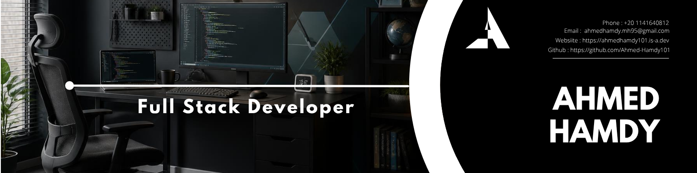

# Ahmed Hamdy

### Full Stack Engineer | Node.js · Next.js · Laravel | AI Integration

> I turn complex business workflows into secure, maintainable software that teams can use every day.

## About me

Full Stack Engineer based in Giza, Egypt, with 5+ years shipping production web platforms. I work across backend architecture, cloud delivery, and AI integration.

- Own a production tour-booking platform end-to-end at **ET GCO Tours** (Next.js 15, Express, PostgreSQL, Redis)
- Lead the rebuild and security hardening of the **Al Kayan Construction & Engineering** platform
- Design API boundaries, data models, authorization, and integrations
- Build AI-powered services with OpenAI, Fastify, and TypeScript

| | |
| --- | --- |
| Location | Giza, Egypt (open to remote) |
| Primary focus | Backend systems, full stack platforms, AI integration |
| Open to | Senior full stack roles, full-time, remote |
| Portfolio | [ahmedhamdy101.is-a.dev](https://ahmedhamdy101.is-a.dev) |

## Selected projects

Every project has a write-up on my portfolio covering the problem, architecture, and decisions.

| Project | What it is | Stack | Links |
| --- | --- | --- | --- |
| **Egypt Tour Guide** (ET GCO Tours) | Bilingual tourism PWA with bookings, real-time inventory, and Redis caching | Next.js 15, Express, TypeScript, PostgreSQL, Drizzle, Redis | [Live](https://www.egypt-tour-guide.com/) · [Source](https://github.com/Ahmed-Hamdy101/et-gco-tours-showcase) · [Case study](https://ahmedhamdy101.is-a.dev/projects/egypt-tour-guide) |
| **Alkayan Construction Nova** | Construction company site on a custom PHP MVC framework with 3D cards and a WebGL hero | PHP, Custom MVC, Three.js, GSAP, PHPUnit | [Live](https://www.alkayan-co.com) · [Source](https://github.com/Ahmed-Hamdy101/alkayan-nova-showcase) · [Case study](https://ahmedhamdy101.is-a.dev/projects/alkayan-nova) |
| **Logger Suite ERP** | Multi-tenant SaaS ERP with RBAC and caching | Next.js 15, Laravel, MySQL, Redis, JWT | [Case study](https://ahmedhamdy101.is-a.dev/projects/logger-suite-erp) |
| **TypeScript AI API** | Fastify REST API exposing OpenAI-powered assistant features through typed endpoints | TypeScript, Fastify, OpenAI, Zod, Docker | [Source](https://github.com/Ahmed-Hamdy101/ts-ai-api) · [Case study](https://ahmedhamdy101.is-a.dev/projects/typescript-ai-api) |
| **Admin REST API** | Laravel API for users, orders, and admin operations with OAuth2 and RBAC | Laravel, Passport, PHP, MySQL | [Source](https://github.com/Ahmed-Hamdy101/laravel-rest-api) · [Case study](https://ahmedhamdy101.is-a.dev/projects/laravel-admin-rest-api) |
| **AutoFix Car Service** | Vehicle repair platform for customers, technicians, and admins with role-based dashboards | Bun, Next.js 16, React 19, TypeScript, Prisma | [Source](https://github.com/Ahmed-Hamdy101/autofix-service-platform-demo) · [Case study](https://ahmedhamdy101.is-a.dev/projects/autofix-car-service) |
| **GIS Sinai Explorer** | Multilingual 3D GIS dashboard for exploring buildings and calculating routes | Next.js, Express, Prisma, PostgreSQL, CesiumJS | [Source](https://github.com/Ahmed-Hamdy101/gis-dashboard) · [Case study](https://ahmedhamdy101.is-a.dev/projects/gis-sinai-explorer) |
| **AWS Fullstack Deployment** | Node.js/TypeScript app on AWS with an automated CI/CD pipeline | Node.js, Express, TypeScript, Elastic Beanstalk, RDS | [Source](https://github.com/Ahmed-Hamdy101/aws-fullstack-deployment) · [Case study](https://ahmedhamdy101.is-a.dev/projects/aws-fullstack-deployment) |
| **Node.js Backend Suite** | Storefront API, image-processing microservice, and a MERN app on AWS | Node.js, Express, PostgreSQL, Redis, EC2 | [Source](https://github.com/Ahmed-Hamdy101/nodejs-store-front-api) |

More on the [full projects page](https://ahmedhamdy101.is-a.dev/projects).

## Core stack

### Languages and frameworks

### Backend and architecture

### Cloud and data

### AI and 3D

Currently learning: NestJS and Go.

## How I work

- **Think in systems:** make boundaries, dependencies, and trade-offs explicit.
- **Raise the quality bar:** security, validation, and testing are part of delivery.
- **Stay pragmatic:** choose the simplest design that can evolve with the product.

## GitHub activity

<table>
<tr>
<td>

</td>
<td>

</td>
</tr>
</table>

## Let's work together

I'm looking for a senior full stack role at a product company where I can own complex problems and ship reliable software.

[Email me](mailto:ahmedhamdy.mh95@gmail.com) | [LinkedIn](https://www.linkedin.com/in/ahmed-hamdy-ah/) | [Schedule a call](https://ahmedhamdy101.is-a.dev/schedule) | [Portfolio](https://ahmedhamdy101.is-a.dev)
